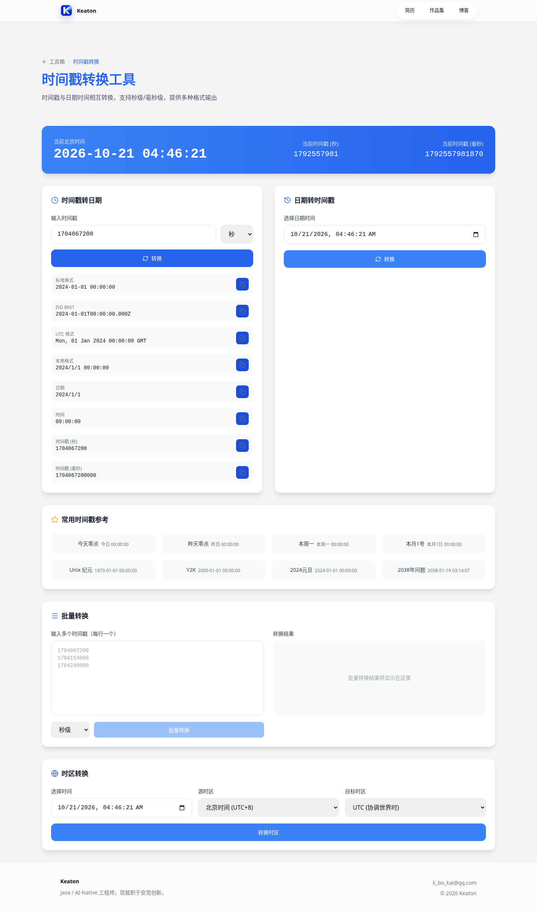
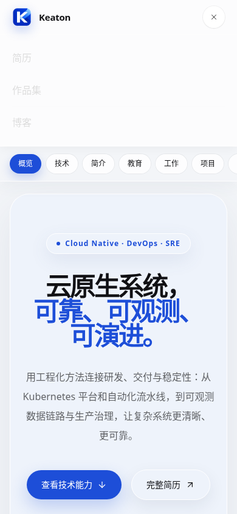

# 个人站 前端组件统一

日期：2026-10-21。保留现有 Vue 框架、产品布局、API 和业务状态，不迁移到 React。

## 来源与适配

基础 Button、Input、Textarea 来自 [shadcn-vue 官方源码](https://github.com/unovue/shadcn-vue/tree/de1f76cbb4b319ea26b0dea175dc00c18fce3bd0/apps/v4/registry/new-york-v4/ui)，底层使用 Reka UI，源码保存在 `components/ui/`，配置见 `components.json`。上游注册表为 `new-york-v4`，本地尺寸、圆角、焦点和变体参考 ClipJar Nova 适配到现有 CSS；**这不是官方 Vue Nova preset**。

- Button 复用 Primitive / CVA 变体；Input / Textarea 保留 v-model，额外公开 `element` 和 `focus()` 以保留原页面的聚焦及选区行为。
- Reka 的 props 显式声明以兼容 Nuxt SFC 类型解析；仍使用上游 Primitive。
- 不启用新的全局 preflight；业务类可以覆盖基础尺寸，页面布局沿用现有样式。
- MIT 授权位于 `public/licenses/`；Nova 样式参考及其 MIT 授权一并保留。
- 界面图标通过 AppIcon 适配为 Lucide；品牌图标继续使用 Nuxt Icon。移动导航使用 Motion Vue，保留 Nuxt SSR，并尊重减少动态效果。
- JSON 搜索在新 Textarea 的 `element` 上设置原生选区；原生 checkbox、select 与局部状态保留。

## 验证

```bash
npm ci
npm run build
npx playwright install chromium
npm run test:ui
```

`test:ui` 默认启动本地预览，退出时关闭。可通过 `PLAYWRIGHT_EXECUTABLE_PATH` 指定系统 Chromium，通过 `UI_BASE_URL` 连接已启动的预览，通过 `UI_SCREENSHOT_DIR` 输出截图。

生产构建和 4 项浏览器场景通过，覆盖 SSR 输出、时间戳双向绑定、JSON 格式化 / 搜索选区、390px 移动导航与路由关闭。SSR 构建保持 Vercel preset；没有执行线上部署。

## 实际截图





[跨项目约定](https://github.com/KeatonLi/clipjar/blob/main/docs/shared-frontend-standard.md)
